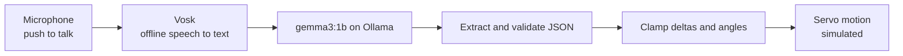

# llm_turret_control

Move a 2-axis turret by talking to it. A spoken command like "look a bit to the left and up" becomes pan and tilt angles, with speech recognition and the LLM both running offline on the laptop.

## The problem

Robots take numbers, people give vague instructions. I wanted to see whether a small local model (1B parameters) is reliable enough to sit between the two, and what has to be put around it so that a bad answer can't move hardware somewhere it shouldn't go.

## What I built

A push-to-talk loop: record, transcribe, ask the model for a movement plan, validate it, move. The servos are simulated for now (the script prints the angle at each step), which let me work on the language side before wiring it to the pan-tilt rig from [Auto-Turret](https://github.com/elie-hallermeier/Auto-Turret).

## Architecture



All of it is in `llm_to_servo.py`.

## Design decisions

- The model outputs deltas, not absolute angles. "A bit to the left" is relative, and a wrong delta is a small error where a wrong absolute angle could be a big one.
- The model's output is treated as untrusted input. The JSON is pulled out of the reply with a regex (small models like to add text around it), the two fields are checked and cast, each delta is clamped to 45 degrees, and the final angles are clamped to 0 to 180. If any step fails, nothing moves.
- The contract with the model is two numbers. A schema this small is something a 1B model can follow, and it keeps the reply short so the round trip stays fast.
- Vosk instead of a larger speech model. It is small, runs on CPU and is accurate enough for short commands.
- Push to talk instead of a wake word, so there is no always-on audio and no false triggers.

## Setup

Needs Python 3 and [Ollama](https://ollama.com).

```bash
ollama pull gemma3:1b
```

```bash
python3 -m venv .venv && .venv/bin/pip install -r requirements.txt
```

Download the Vosk model and unzip it into `models/`:

```bash
mkdir -p models && curl -L -o models/vosk.zip https://alphacephei.com/vosk/models/vosk-model-small-en-us-0.15.zip && unzip -q models/vosk.zip -d models
```

## Run

```bash
.venv/bin/python llm_to_servo.py
```

Press Enter, say a command, press Enter again. The script prints what it heard, the model's raw reply, how long the model took, and the simulated servo angles.

## Next

- Drive the real servos through a PCA9685
- Keep listening in a loop so commands build on each other
- Let the model see the camera so "point at the door" works

## License

MIT, see [LICENSE](LICENSE).
